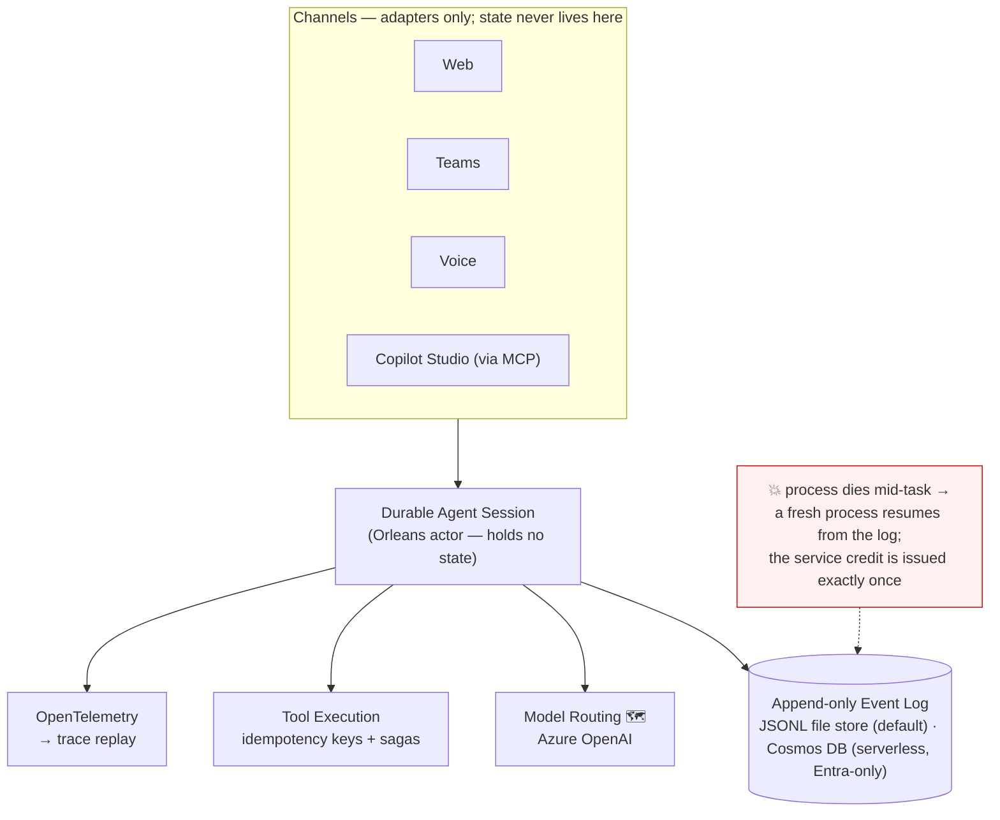

# Aurelia

**A durable execution runtime for AI agents — agents that survive crashes, replay deterministically, and never double-execute a side effect.**

[](https://github.com/parammadan/aurelia/actions/workflows/ci.yml)


## The Problem

A customer-service agent — the kind Copilot Studio powers for a Dynamics 365 Contact Center — is mid-case. It has pulled the case from Dataverse, verified the customer, and is halfway through issuing a service credit when its pod is rescheduled. Today's agent frameworks keep the session in process memory, so everything dies with the process: the conversation, the plan, and — worst — the answer to *"was the credit issued?"* Nobody knows. The customer calls back to an agent with amnesia, and a DRI reconciles the ledger by hand.

Workflow engines solved crash recovery a decade ago — Azure Durable Functions, the Durable Task Framework, Temporal — by replaying deterministic orchestration code against a history of recorded results. Agents break that model's core assumption: their orchestration logic *contains LLM calls*, which are nondeterministic even at temperature zero. You cannot re-run the plan and expect the same plan.

Aurelia is what durable execution looks like when it is redesigned for agents.

## Architecture in 90 seconds



## What "durable" means here

| Guarantee | Mechanism | Status |
|---|---|---|
| Crash mid-task → resume with correct state | Event-sourced sessions; every call's intent is durable *before* execution | ✅ tested in CI on every commit |
| Deterministic replay of any run | Fold-over-log reconstruction; all nondeterminism recorded as events | ✅ tested in CI (reconstruction mode) · 🗺️ fork-based re-execution |
| Side effects execute exactly-once or compensate | Deterministic idempotency keys + saga compensation | ✅ tested in CI (kill mid-credit → exactly one ledger entry; failed notify → credit reversed) |
| Pause for human approval indefinitely | Approval as a durable two-phase call; "paused" is derived, not stored | ✅ tested in CI (pause, cross-process resume, denial unwind) · 🗺️ expiry |
| Mid-session channel handoff | Session–channel decoupling | 🗺️ planned (sessions hold no channel state by design; no channels built yet) |

## See it survive

The first thing in CI — before any feature existed — is a test that kills the runtime for real:

```csharp
// tests/Aurelia.CrashTests/CrashRecoveryTests.cs (abridged)
using (var victim = StartHost(sessionId, goal, storeDir, signalDir))
{
    await WaitUntilAsync(() => Directory.EnumerateFiles(signalDir, "*.started").Any());
    victim.Kill(entireProcessTree: true);              // SIGKILL, mid-tool-call
}

var afterCrash = await store.ReadAsync(sessionId);
Assert.Contains(afterCrash, e => e is ToolCallRequested);   // the intent is durable
Assert.DoesNotContain(afterCrash, e => e is CallOutcome);   // the outcome is not

using var survivor = StartHost(sessionId, goal, storeDir, signalDir);  // fresh process
Assert.Equal(0, survivor.ExitCode);

var success = Assert.Single(finalLog.OfType<ToolCallSucceeded>());     // exactly once
Assert.Equal(request.IdempotencyKey, success.IdempotencyKey);

var replayed = await new ReconstructionReplayEngine(store).ReplayAsync(sessionId);
Assert.Equal(completed.FinalStateJson, replayed.FinalStateJson);       // replay == live
```

[The real test](tests/Aurelia.CrashTests/CrashRecoveryTests.cs) · [CI runs](https://github.com/parammadan/aurelia/actions/workflows/ci.yml)

The same harness also kills the case-resolution reference agent mid-`issue_service_credit` and asserts the ledger holds **exactly one** credit after recovery — and, in a separate test, that a failed customer notification triggers the saga unwind: the credit is reversed and the session parks as `SessionFailed` with an explicit list of what was and wasn't compensated.

## Quick start

Prerequisite: [.NET SDK 10.0.3xx](https://dotnet.microsoft.com/download/dotnet/10.0).

```bash
git clone https://github.com/parammadan/aurelia && cd aurelia

# Run the whole suite, including the SIGKILL crash-recovery contract (~5 s):
dotnet test

# Run the case-resolution agent, then replay it deterministically from its event log:
dotnet run --project src/Aurelia.Runtime -- run    --session-id demo --goal "issue service credit for case 42" --store-dir /tmp/aurelia --agent case-resolution
dotnet run --project src/Aurelia.Runtime -- replay --session-id demo --store-dir /tmp/aurelia

# Case 7's $40 credit exceeds the manager-approval threshold — the run pauses,
# a manager approves from a different process, and the same command resumes:
dotnet run --project src/Aurelia.Runtime -- run     --session-id c7 --goal "credit for case 7" --store-dir /tmp/aurelia --agent case-resolution
dotnet run --project src/Aurelia.Runtime -- approve --session-id c7 --store-dir /tmp/aurelia --key c7/0/1 --approver manager
dotnet run --project src/Aurelia.Runtime -- run     --session-id c7 --goal "credit for case 7" --store-dir /tmp/aurelia --agent case-resolution

# Run the eval suite (13 scenarios: happy paths, sagas, approvals, idempotent reruns, replay checks):
dotnet run --project src/Aurelia.Runtime -- eval --suite evals/phase1.json
```

That is everything that works today: build, tests, the demo session, and replay. There is no hosted playground, no Teams bot, and no Cosmos DB deployment yet — see the roadmap.

## Design decisions

Every design decision lands as an ADR before the code that depends on it. The load-bearing ones:

| ADR | Decision |
|---|---|
| [0002](docs/adr/0002-crash-recovery-harness-is-the-ci-contract.md) | The SIGKILL crash-recovery test is the CI contract, from the first commit |
| [0004](docs/adr/0004-replay-is-reconstruction-first.md) | Replay is reconstruction (a pure fold); counterfactual re-execution is a separate, later concept |
| [0005](docs/adr/0005-results-match-by-key-checked-against-position.md) | Recorded results match by deterministic key, asserted against log position |
| [0006](docs/adr/0006-core-may-not-read-time-or-randomness.md) | Core code may not read the clock or randomness — enforced by a Roslyn analyzer |
| [0007](docs/adr/0007-flat-log-with-turn-step-attributes.md) | One flat, totally-ordered event log per session; turn/step ordinals on every envelope |
| [0008](docs/adr/0008-external-calls-are-two-phase-events.md) | Every external call is two events: intent before execution, then outcome |
| [0010](docs/adr/0010-keys-identify-logical-calls-attempts-numbered.md) | Idempotency keys identify logical calls and survive retries — the exactly-once mechanism |
| [0011](docs/adr/0011-approval-is-a-slow-external-call.md) | Human approval is just a very slow external call; "paused" is derived state |
| [0015](docs/adr/0015-compensation-is-an-external-call.md) | Saga compensation is itself a two-phase call in the log |

Full log, including superseded decisions, in [docs/adr](docs/adr/README.md). The one-line summary of the philosophy: **non-determinism in the core is a compile error (`AUR0006`), not a code-review comment.**

## Relationship to the ecosystem

- **Copilot Studio and low-code agent platforms** — complementary. They decide *what* an agent does; Aurelia makes *doing it* survivable. The integration path is MCP, and it exists: `src/Aurelia.Mcp` exposes sessions as MCP tools (start / inspect / approve / resume / replay), registered for this repo in `.mcp.json`. Because sessions are durable, the async pattern is free — a session can pause in one MCP server process and be approved and finished by another. No authoring UI, no connector catalog — by design.
- **Temporal / Durable Task Framework** — inspiration. Aurelia adapts durable execution to nondeterministic orchestration logic: recorded-event substitution instead of deterministic-code replay, and (planned) fork-based counterfactuals instead of divergent replays.
- **LangGraph and agent frameworks** — a different layer. They help you write agents; Aurelia is the runtime that keeps them alive.

## Roadmap

Planned ≠ built. Nothing below exists yet.

- 🗺️ Blob Storage offload for large event payloads (the Cosmos DB event store exists: partition per session, head-document optimistic concurrency, Entra-only — set `AURELIA_COSMOS_ENDPOINT`; see [ADR-0019](docs/adr/0019-cosmos-event-store.md) and `infra/main.bicep`)
- 🗺️ Multi-agent coordination, context/memory tiers, Semantic Kernel interop. (Model *routing* exists today: route classes resolved by a named policy, per-route latency budgets with fallback, the decision recorded on the intent — [ADRs 0020–0022](docs/adr/README.md). Durable model calls talk to any OpenAI-compatible endpoint via `AURELIA_MODEL_ENDPOINT` — a local Ollama, vLLM on a GPU cluster, or Azure OpenAI.)
- 🗺️ The **Orchestration Reliability Benchmark** — failure-injection scoring of *recovery rate* and *correctness after failure*, across frameworks. The [methodology draft](docs/benchmark/methodology.md) is written (rules before results, deliberately); the harness seeds exist and run in CI today (SIGKILL crash tests, seeded chaos API, eval runner, two pilot experiments in `docs/experiments/`)
- 🗺️ *Hosted* playground and trace viewer (both exist locally today: `dotnet run --project src/Aurelia.Playground` → http://localhost:5199 — start a session, press 💥 to SIGKILL the real worker mid-task and watch a fresh process resume, then open its trace: a timeline of every call with exact prompts, outputs, routing decisions, and retries, straight from the event log — file or Cosmos)
- 🗺️ Teams bot (Azure Bot Service), browser voice, and the mid-session channel handoff
- 🗺️ Copilot Studio connector configuration for the existing MCP server (the server itself works today; see ecosystem section)

## License & contributing

License: TBD (the repository is private while that is settled). Design conversations happen in [docs/adr](docs/adr/README.md); the crash test is the bar every change must clear.

Built by Param Madan — design notes in [docs/adr](docs/adr/README.md).
