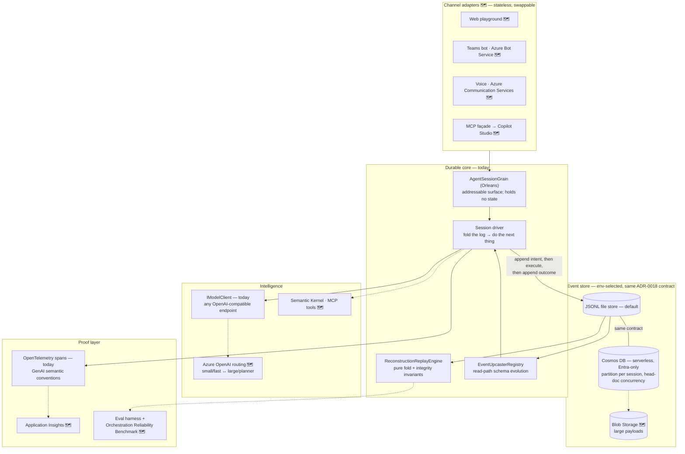

# Aurelia architecture

The detailed version of the README diagram, and the *why* behind each layer.
Everything marked 🗺️ is planned, not built; everything else exists in this
repository today and is exercised by CI.

## Sessions are event logs

A session's only durable truth is its append-only event log; the current state
is a fold over that log. Each session is one flat, totally-ordered log
(ADR-0007) — which maps naturally onto a Cosmos DB partition per session later —
and every event envelope carries the session ID, a strictly-increasing
sequence, turn and step ordinals, a per-type schema version, and a
`RecordedAt` timestamp that is observability metadata only.

The ordinals are load-bearing. A *turn* is one activation of the agent; a
*step* is one external call issued within it. From those stamps the
deterministic idempotency key `session/turn/step` is derived by pure
arithmetic (ADR-0005, ADR-0010) — it is computed, never stored, so it can
never drift from the coordinates. Outcome events inherit their intent's
coordinates (ADR-0012), which means the key identifies the *whole logical
call* even when the outcome arrives days later; consumers order by sequence,
never by coordinates.

The log is immutable and must replay years after it was written, so schema
evolution happens on the read path: each event type carries an integer schema
version, and registered upcasters lift old shapes to the current one,
version by version, before deserialization (ADR-0009). The fold, recovery,
and replay only ever see the latest schema.

## The two-phase call protocol

Every external call — tool invocation, model call, human approval, injected
time or randomness — produces two phases of events: an **intent**, durable
*before* execution begins, carrying the call's full inputs; then a terminal
**outcome** carrying the result or error and an attempt number (ADR-0008).
This ordering is what makes crashes legible. An intent without an outcome
tells a recovering process exactly where death occurred — and, critically,
that the call *may already have had side effects*. That distinction is the
entire compensation problem, and a single write-after-completion event cannot
make it.

Exactly-once for side-effectful calls rests on the key: because it is
identical across every retry attempt, downstream systems can deduplicate on
it. Where deduplication is impossible, the saga path takes over: compensation
is *itself* a two-phase external call (`CompensationRequested`, with a link to
the key it reverses — ADR-0015), tools opt into reversibility via
`ICompensatableTool` (ADR-0016), and a compensation that fails after retries
parks the session in a terminal `SessionFailed` state that lists exactly which
keys were and were not unwound (ADR-0017). Nothing is silent; nothing blocks
forever. (All of this is implemented and CI-tested — the unwind engine, keyed
retries, and approval pause/resume; approval *expiry* awaits the
time-injection machinery.)

Human-in-the-loop follows the same shape rather than getting its own
machinery: an approval is just a very slow external call (ADR-0011). "Paused
awaiting approval" is a derived condition — the latest intent has no outcome —
so recovering a session that has been paused for a week is *identical* to
recovering one that crashed a second ago.

## Replay and the determinism ban

Temporal-style replay re-runs deterministic workflow code and substitutes
recorded results. An agent's orchestration logic contains LLM calls, so that
assumption is dead on arrival. Aurelia's answer (ADR-0004): Phase 1 replay is
**reconstruction** — a pure fold over the log in which every external result
is substituted from the recording and nothing is re-executed. It is
deterministic by construction, and the fold doubles as an integrity checker:
sequence regressions, outcomes without intents, second terminal outcomes, and
compensations referencing unknown keys all fail loudly rather than
reconstructing quietly. Because intents record *full inputs* (exact prompt,
model ID, parameters, config version), fork-based re-execution — "same
session, different model, diff the runs" — can be added later without a
schema migration; it is an experiment concept, not a replay mode.

Determinism is enforced, not hoped for. Core code may not read the wall clock
or randomness (ADR-0006): decision-relevant time and random values arrive as
injected, recorded events, and `RecordedAt` is metadata core logic never
reads. The rule is compiled in — a Roslyn analyzer (`AUR0006`) makes
`DateTime.UtcNow`, `Random`, `Guid.NewGuid`, `Stopwatch`, and friends build
errors inside `src/Aurelia.Core`, with its own test suite proving both
directions (banned APIs flagged; legitimate use of recorded values untouched).

## Orleans and session–channel decoupling

The Orleans grain (`AgentSessionGrain`) is the addressable surface of a
session — one grain per session ID — but it holds no state whatsoever: every
activation folds the log and continues. That makes process death boring
(the CI contract kills the host with SIGKILL on every commit and asserts a
fresh process completes the session correctly) and it is the foundation for
channel handoff 🗺️: if a session is only its log, then any channel adapter —
web, Teams, voice, a Copilot Studio agent calling via MCP — can attach to,
detach from, or hand off a live session. Channels are costumes; the log is
the body. No channel work exists yet; the discipline that makes it cheap
(state never lives in the adapter layer) is enforced from the first commit.

## The proof layer

Claims about reliability are cheap, so the proof layer is scaffolded first.
Every session run emits OpenTelemetry spans today (`session.run`, with
child `execute_tool` spans tagged per the GenAI semantic conventions), with
OTLP export gated behind the standard environment variables — point it at an
Aspire dashboard or Jaeger and watch a run live. Application Insights is the
planned 🗺️ production sink, feeding the trace replay viewer. The end state 🗺️
is the Orchestration Reliability Benchmark: a failure-injection suite (tool
timeouts, malformed model output, mid-run kills, poison messages) that scores
any agent framework on recovery rate and correctness-after-recovery — the
CI kill test, grown up and pointed at the whole industry.
